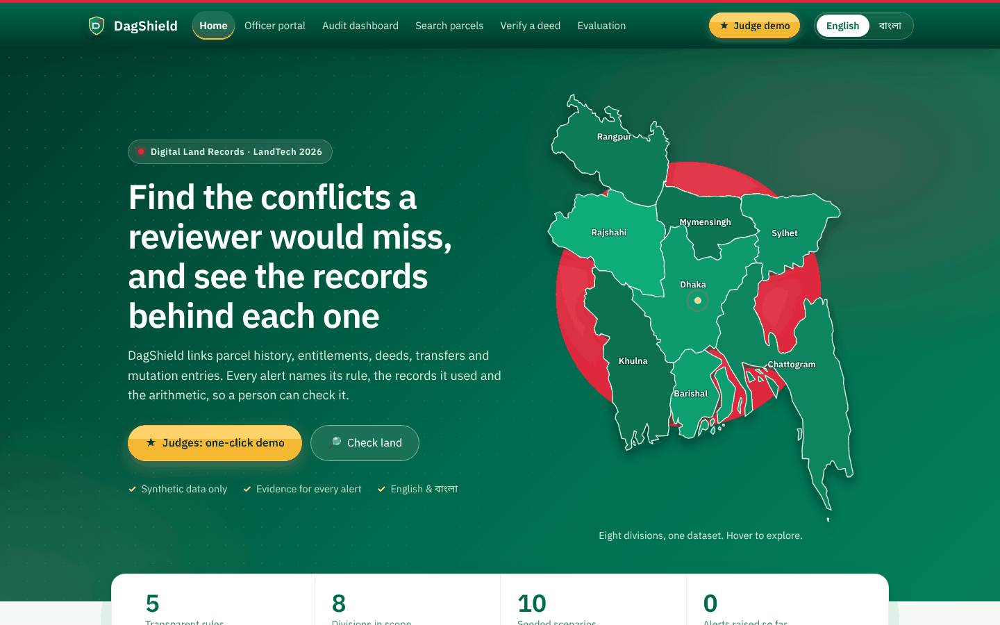
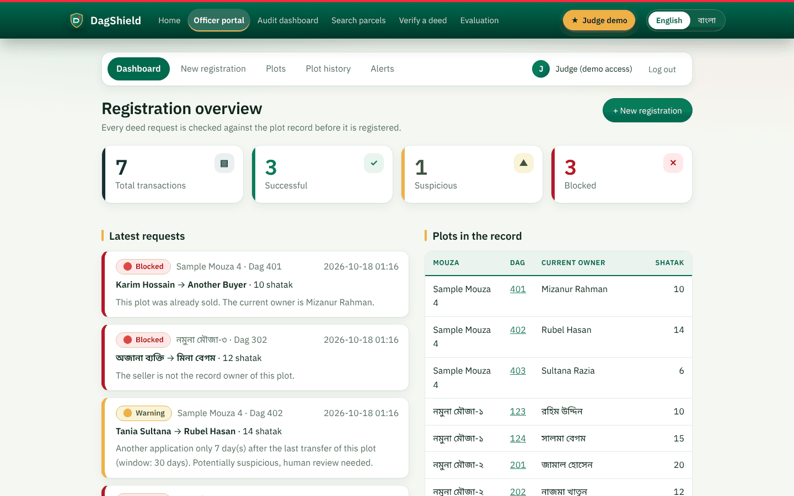
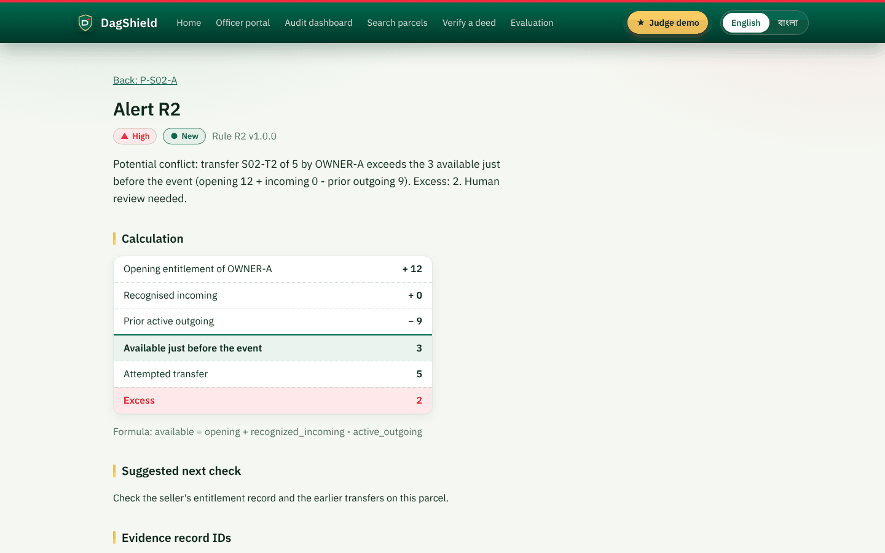
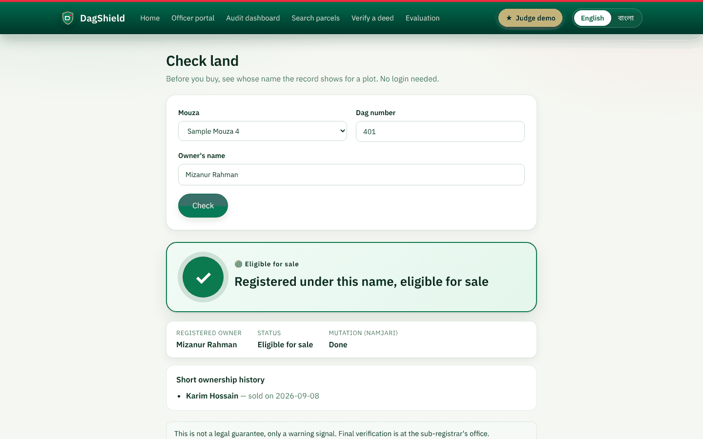
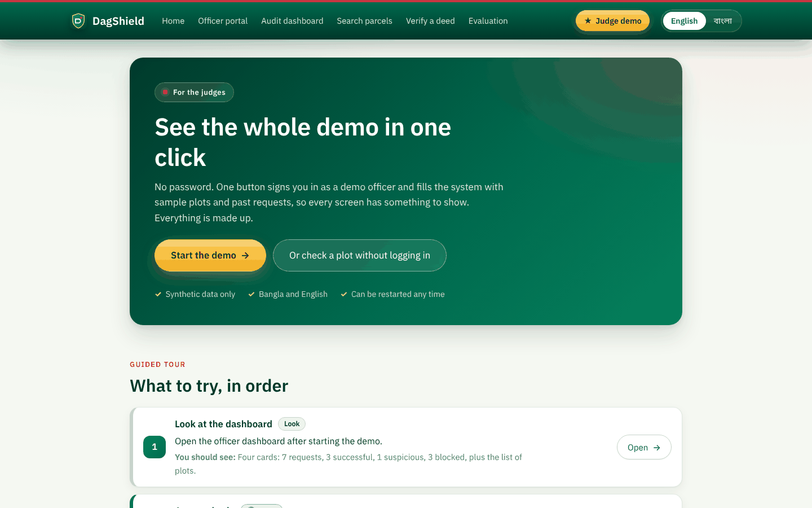

<div align="center">


<br>

[](https://github.com/gulamsakaria/dagshield/actions/workflows/ci.yml)
[](LICENSE)


**A web prototype for the LandTech 2026 hackathon, problem statement P3: Fraud and Double-Selling Detection**
(Digital Land Records track)

[**Live demo**](https://dagshield.newslensbd.com) &nbsp;·&nbsp; [Quick start](#quick-start) &nbsp;·&nbsp; [How it works](#how-it-works) &nbsp;·&nbsp; [Docs](#documentation) &nbsp;·&nbsp; English and বাংলা

</div>

---

DagShield links parcel lineage, ownership entitlements, deeds, transfer events and mutation entries, flags
*potential* conflicts with deterministic rules, and **proves every flag with record IDs and arithmetic**.
It checks every new deed against the plot record before it is registered, lets anyone check whose name a plot is
recorded under, and signs each synthetic deed so a copy can be verified by QR code.

> [!IMPORTANT]
> **Synthetic data only.** Every record in this repository was created by the team. No real personal data, no real
> land records, nothing scraped from any government portal. DagShield is a screening aid for human review. It is not a
> title search, a legal opinion, or proof of ownership or fraud.

<div align="center">

</div>

## Highlights

- **Evidence, not scores.** Each alert shows its rule ID and version, the evidence record IDs, the calculation, a plain-language explanation and a suggested next check.
- **Deterministic and reproducible.** The rules are pure, versioned functions. **No AI model is used at run time**, so identical input always gives identical output.
- **Pre-registration deed check.** An officer enters a deed and gets green, yellow or red with the reason, before anything is registered.
- **Public Check Land page.** Anyone picks a mouza, types a dag number and an owner name and gets an answer in Bangla or English. No login.
- **Tamper-evident deeds.** SHA-256 hash, Ed25519 demo signature, QR code, a verify page that names the changed field, and a hash-chained audit log.
- **Honest wording, enforced by tests.** Alerts say "potential conflict", "record mismatch", "not found in supplied dataset" and "human review needed". They never say "fraud confirmed" or "ownership verified".
- **Bangla and English UI.** Labels and explanations switch language; results never change.

## Screenshots

<table>
  <tr>
    <td width="50%"><br><sub><b>Officer dashboard.</b> Every deed request is checked against the plot record first.</sub></td>
    <td width="50%"><br><sub><b>Alert evidence.</b> Rule, calculation (opening + incoming - outgoing) and the records used.</sub></td>
  </tr>
  <tr>
    <td width="50%"><br><sub><b>Check Land (public).</b> Whose name is the plot recorded under, and is the mutation done?</sub></td>
    <td width="50%"><br><sub><b>Judge demo.</b> One click loads sample data, then a 12-step guided tour.</sub></td>
  </tr>
</table>

## How it works

### The five rules

| Rule | Looks for | Example result |
| --- | --- | --- |
| **R1** Overlapping transfer claim | Two active transfers claiming the same portion of a parcel | Links both records as evidence |
| **R2** Transfer exceeds entitlement | A seller transferring more than they hold at that moment | "3 available, 5 attempted, excess 2" |
| **R3** Deed and mutation gap | A deed with no matching mutation (namjari) entry | "Not found in supplied dataset" |
| **R4** Lineage or area anomaly | Child parcels that do not add up to the parent, or a low-confidence parent link | Review alert, nothing is merged |
| **R5** Rapid-transfer heuristic | Several transfers in a short window | A heuristic alert only |

A missing value is never treated as zero: it gives "insufficient data". A cancelled transfer stops counting from its
cancellation date.

### Pages

| Address | Page | Login |
| --- | --- | --- |
| `/` | Home with a map of Bangladesh's eight divisions (geoBoundaries, CC0) | no |
| `/judge` | Judge demo: one-click start and guided tour (only when switched on) | no |
| `/check` | Check Land, public | no |
| `/officer/login`, `/officer` | Officer login and dashboard | yes (except login) |
| `/officer/new`, `/officer/result/:id` | New deed registration and its check result | yes |
| `/officer/plots` | All plots, and add a plot | yes |
| `/officer/history`, `/officer/alerts` | Plot ownership timeline, alert list | yes |
| `/dashboard` | Audit dashboard: run R1 to R5 on the ten seeded scenarios | no |
| `/search`, `/parcels/:id`, `/alerts/:id` | Parcel search, parcel history, alert evidence | no |
| `/verify` | Check a deed copy (hash, signature, QR) | no |
| `/evaluation` | Evaluation counts (actual TP, FP and FN on the labeled fixtures) | no |

## Quick start

### Docker (one command)

```bash
python scripts/gen_demo_key.py     # creates .env with a demo signing key and a random DB password
docker compose up --build
```

Web UI: <http://localhost:8080> · API docs: <http://localhost:8000/docs>. Both ports are bound to `127.0.0.1` only.

### Local development (no Docker)

On Windows, `start_dev.bat` starts both servers. By hand:

```bash
python scripts/gen_demo_key.py                       # once
# in .env set:  DAGSHIELD_PUBLIC_BASE_URL=http://localhost:5173

cd backend
python -m venv .venv && source .venv/bin/activate    # Windows: .venv\Scripts\activate
pip install -r requirements-dev.txt
uvicorn app.api.main:app_factory --factory --reload --port 8000   # uses SQLite by default

cd ../frontend                                       # in a second terminal
npm install
npm run dev                                          # http://localhost:5173
```

To use PostgreSQL locally, run everything with compose, or start only the database with `docker compose up db`
(it needs a published port) and set `DATABASE_URL=postgresql+psycopg://...`.

<details>
<summary><b>Settings (<code>.env</code>, see <code>.env.example</code>)</b></summary>

<br>

| Variable | Meaning |
| --- | --- |
| `DAGSHIELD_SIGNING_KEY` | Ed25519 demo key, 32 bytes in base64. Required. Made by `scripts/gen_demo_key.py` |
| `DAGSHIELD_OFFICER_USER`, `DAGSHIELD_OFFICER_PASSWORD` | Officer portal login. Built-in demo defaults exist for a local run (shown on the local login page). **Set your own for anything shared** |
| `DAGSHIELD_JUDGE_LOGIN` | Optional, default off. `true` shows the one-click Judge demo (a passwordless officer session). Use it only on a synthetic-data demo or judging server |
| `DAGSHIELD_ADMIN_TOKEN` | Optional. If set, resetting a scenario or changing an alert status needs it (type it in the footer box of the site) |
| `DAGSHIELD_STATIC_DIR` | Optional. Folder of the built web UI. When set, the API serves the site itself (used for cPanel hosting) |
| `DAGSHIELD_PUBLIC_BASE_URL`, `DAGSHIELD_ALLOWED_ORIGINS` | Where QR codes point, and which origins may call the API |
| `DATABASE_URL` | SQLite by default; PostgreSQL in Docker |
| `DAGSHIELD_RATE_LIMIT_PER_MIN`, `DAGSHIELD_ENABLE_DOCS` | Request limit per client, and the `/docs` page on or off |
| `DAGSHIELD_R5_WINDOW_DAYS` and other rule parameters | Rule tuning (areas are in decimal) |

The frontend build reads one optional variable: `VITE_SHOW_DEMO_LOGIN=false` hides the demo password on the login page
(the hosted copy is built this way).

</details>

### Tests

```bash
cd backend && pytest                 # 102 tests: golden rules, integrity, audit log, API, officer portal, public check, hosting, security
ruff check .                         # lint, including security rules
cd ../frontend && npm run typecheck && npm run build
python scripts/check_secrets.py && python scripts/check_synthetic_data.py   # also run in CI
```

## Demo walkthroughs

<details>
<summary><b>Officer portal</b>: the four-plot demo registry and what each result means</summary>

<br>

Open `/officer` and sign in. Locally the demo account is printed on the login page. The registry is hand-entered
synthetic data with four plots and made-up names:

| Mouza | Dag | Owner | Shatak | Note |
| --- | --- | --- | --- | --- |
| নমুনা মৌজা-১ | 123 | রহিম উদ্দিন | 10 | |
| নমুনা মৌজা-১ | 124 | সালমা বেগম | 15 | |
| নমুনা মৌজা-২ | 201 | জামাল হোসেন | 20 | |
| নমুনা মৌজা-২ | 202 | নাজমা খাতুন | 12 | mutation (namjari) still pending |

On **New registration** the form checks the deed before anything changes:

| Result | When | Rule |
| --- | --- | --- |
| Green | The seller holds the land and the area fits. Ownership moves to the buyer (partial sales split the holding) | |
| Red | The plot was already sold: "বর্তমান মালিক …" | R1 |
| Red | The seller is not the record owner, or sells more shatak than the record holds | R2 |
| Red | Mouza and dag are not in the registry | R0 |
| Yellow | Another application within `DAGSHIELD_R5_WINDOW_DAYS` (30) of the plot's last transfer, or a deed dated before it. Registered, but flagged (a heuristic) | R5 |

Four demo chips under "Demo scenarios" fill the form for the normal sale, the double sale, the false seller and the quick
resale. The **Plots** tab lists every plot in the registry and adds new ones (mouza, dag, owner, area); names can be typed
in Bangla or English, and case and extra spaces are ignored. "Reset demo data" on the dashboard restores the four plots.

Not in the demo (listed as future plans in the concept note): owner login, real SMS or OTP, NID, maps or GIS checks, OCR.

</details>

<details>
<summary><b>Judge demo</b>: one click, sample data, guided tour</summary>

<br>

With `DAGSHIELD_JUDGE_LOGIN=true` a gold **Judge demo** button appears in the top bar, on the home page and on the officer
login page. It opens `/judge`, where **Start the demo** signs the judge in as "Judge (demo access)", resets the registry
and loads sample data, then opens the officer dashboard. No password.

Sample data (`backend/app/registry/sample.py`): five more plots (Bangla and English names) and seven past requests that
are run through the real checker, so the dashboard shows 7 requests (3 successful, 1 suspicious, 3 blocked). One owner's
mutation is finished (green on the public page), the others are pending (amber).

The guide lists twelve steps in order. Links such as `/officer/new?demo=2` open the form with a scenario filled in, and
`/check?mouza=...&dag=...&name=...` opens the public page filled in. "Restart the demo" resets everything again. Because
Start and Restart reset the shared registry, two judges using the live site at the same moment would disturb each other.
The judge session is a normal signed token (`j` instead of `o`), has the same rights as the officer, and works only while
the switch is on.

</details>

<details>
<summary><b>Check Land (public)</b>: the four possible answers</summary>

<br>

`/check` reads the same registry tables as the officer portal, so a deed registered by an officer shows up at once.

| Answer | When |
| --- | --- |
| Green "এই নামেই আছে, বিক্রির যোগ্য" | The name is a registered owner **and** the mutation is done |
| Amber "…নামজারি বাকি। আবার বিক্রি সন্দেহজনক।" | The name is a registered owner but the khatian still names someone else |
| Red "এই নামে নেই। বর্তমান মালিক: …" | The name is not an owner; if that person sold earlier it also shows "আগেই বিক্রি হয়েছে" and the date |
| Amber "এই দাগ রেকর্ডে পাওয়া যায়নি" | Mouza and dag are not in the registry |

A deed changes the *registration* owner at once, but the *khatian* owner changes only when the mutation is completed
(`POST /api/registry/mutations/complete`, officer only; there is no button for it), so a freshly registered owner shows
amber until then. The page returns only the registered owner, a status, the mutation status and earlier owners with
dates, never alerts, scores, officer names or the audit log. Each check writes one audit-log line with mouza and dag only.
It limits itself to 10 checks a minute in the browser, and the server limits each client too.

</details>

<details>
<summary><b>Seeded scenarios</b>: ten labeled fixtures with expected output</summary>

<br>

Ten labeled fixtures live in `fixtures/scenarios/`. Each ships with its own expected output, which is what the
golden tests and the Evaluation page compare against.

| Scenario | Expected |
| --- | --- |
| clean-transfer | No alert. Entitlement 12, outgoing 5, balance 7 |
| excess-transfer | R2 on the second transfer: 3 available, 5 attempted, excess 2 |
| duplicate-portion | R1 links both records |
| cancelled-duplicate | No R1 alert (cancelled event excluded) |
| missing-mutation | R3 "not found in supplied dataset" |
| ambiguous-lineage | R4 review alert, nothing merged |
| child-area-anomaly | R4 shows a difference of 2 (parent 20, children 22) |
| missing-value | "Insufficient data" (R2, R3), never treated as zero |
| rapid-transfers | R5 heuristic alert only |
| duplicate-and-gap | R1 and R3 together |

Plus integrity cases (genuine deed, tampered deed, intact and broken audit log) run from code.

</details>

## Architecture

```
backend/app/rules/       R1-R5 as pure, versioned functions (no HTTP, no database)
backend/app/integrity/   canonical JSON, SHA-256, Ed25519, QR payload, copy verification
backend/app/auditlog/    hash-chained append-only log (pure functions)
backend/app/registry/    officer portal and public check: checker.py (deed check, pure), service.py,
                         public.py (Check Land), khatian.py (mutation), auth.py (login and tokens)
backend/app/db/          SQLAlchemy tables, fixture loading, signing at seed time
backend/app/api/         FastAPI routes (routes, registry_routes, public_routes), security headers,
                         rate limit, static_site.py (serves the built UI when hosted)
backend/tests/           golden tests and API, officer, public and hosting tests
fixtures/scenarios/      synthetic seed data with expected outputs
frontend/src/            React + TypeScript + Vite: pages/ (public pages), officer/ (officer portal),
                         components/, i18n.tsx (English and Bangla), bdMap.ts (map outlines)
scripts/                 key and secret checks, cPanel package builder, FTP uploader
docs/                    concept note, demo script, project report (Bangla), deploy guide, licence notes
```

**Stack:** Python 3.12 (3.11 or newer), FastAPI, SQLAlchemy, PostgreSQL in Docker (SQLite for local runs and the hosted
copy), React 18, TypeScript, Vite.

**API groups:** `/api/scenarios`, `/api/audits`, `/api/alerts`, `/api/parcels`, `/api/deeds`, `/api/verify`,
`/api/evaluation`, `/api/audit-log` (screening); `/api/auth`, `/api/registry/*` (officer, token needed);
`/api/public/*` (Check Land). Interactive docs are at `/docs` unless `DAGSHIELD_ENABLE_DOCS=false`.

<details>
<summary><b>Rule notes and simplifications</b></summary>

<br>

- Areas use one unit (decimal; shatak in the officer portal). Conversion from bigha or katha belongs at data load,
  never inside rules.
- Events are ordered by date, with ties broken by event ID.
- A cancelled or reversed transfer stops counting from its cancellation date (R2). R1 ignores transfers whose
  status is not `active`. A cancellation with no date is reported as "insufficient data".
- A missing value is never treated as zero. An owner with no entitlement record and no incoming transfer gives
  "insufficient data". An owner who holds land only through recorded incoming transfers has opening 0.
- `portion_key` is a **synthetic stand-in**. A production system would derive it from the deed's described area
  and boundaries mapped to the parcel split recorded at mutation. See [`docs/internal/qa-prep.md`](docs/internal/qa-prep.md).
- The deed check proves a copy matches a signed record. A deed forged at the source and then signed passes it;
  R1 to R4 are the second line of defence.
- The officer portal's deed check (R0, R1, R2, R5) and Check Land compare names as typed: case and extra spaces are
  ignored, but "রহিম উদ্দিন" and "Rahim Uddin" are different people to the program.

</details>

### Performance

Target: search and audit under 2 seconds on up to 1,000 synthetic records. Tests assert this
(`test_rules_are_fast_on_1000_records`, `test_search_and_audit_stay_under_2_seconds_with_1000_parcels`).

## Hosting on cPanel (one domain, one Python app)

The API can also serve the built web UI, so a single Python app hosts everything (`DAGSHIELD_STATIC_DIR`). The live demo
runs this way on cPanel "Setup Python App" with SQLite.

```bash
python scripts/build_cpanel_package.py --domain your.domain.example   # builds ../cpanel-package/ with fresh secrets
python scripts/upload_ftp.py --creds ftp.local.txt --local ../cpanel-package/dagshield_app --remote dagshield_app
```

Then create the app in cPanel (Python 3.11 or newer, startup file `passenger_wsgi.py`, entry point `application`), run
Pip Install on `requirements.txt` and restart. Full steps, in Bangla: [`docs/deploy-cpanel-bn.md`](docs/deploy-cpanel-bn.md).
The package folder (it holds the `.env` and the officer password) and `ftp.local.txt` stay outside the repository or are
git-ignored. Never commit them.

## Documentation

| Document | What it covers |
| --- | --- |
| [`SECURITY.md`](SECURITY.md) | Security design, threats and known limits |
| [`docs/DagShield-Concept-Note.pdf`](docs/DagShield-Concept-Note.pdf) · [`draft text`](docs/concept-note-draft.md) | The concept note (3 pages) |
| [`docs/demo-script.md`](docs/demo-script.md) | Step-by-step demo script |
| [`docs/project-report-bn.md`](docs/project-report-bn.md) | Full project report, in Bangla |
| [`docs/deploy-cpanel-bn.md`](docs/deploy-cpanel-bn.md) | Deploying on cPanel, in Bangla |
| [`docs/data-and-licence-notes.md`](docs/data-and-licence-notes.md) | Data sources and licence notes |
| [`docs/ai-tool-disclosure.md`](docs/ai-tool-disclosure.md) | AI tool disclosure (required by the hackathon rules) |
| [`THIRD_PARTY_LICENSES.md`](THIRD_PARTY_LICENSES.md) | Third-party libraries and their licences |
| [`docs/internal/`](docs/internal) | Team working papers: team agreement, Q&A prep, submission checklist, organizer queries |

## Design and fonts

The look follows a calm green, white and card layout in the spirit of public-service sites, without any government logo,
symbol, text or code. The shield logo, name and layout are our own. Fonts: IBM Plex Sans and Noto Sans Bengali, both under
the SIL Open Font Licence 1.1 (see [`THIRD_PARTY_LICENSES.md`](THIRD_PARTY_LICENSES.md)). The home-page map uses geoBoundaries (CC0).

## AI tools used

The hackathon rules ask for every AI tool to be listed, so here it is.

- **Claude (Anthropic)** was used as a coding assistant during development: explaining the problem brief, drafting the first scaffold of the backend, tests, frontend, Docker files and documents, and later redesigning the web UI, building the officer portal, the public Check Land page and the cPanel hosting package.
- The team ran, tested and reviewed the generated code. The automated tests in [`backend/tests/`](backend/tests) cover it, and both team members can explain every module.
- **No AI model is used at run time.** The rules are deterministic, so identical input always gives identical output.

Details: [`docs/ai-tool-disclosure.md`](docs/ai-tool-disclosure.md).

## Development note

DagShield was built locally by the team and then published here. This repository was created on 17 to 18 October 2026, so its commit history starts there; the history is kept as it happened.

## Team

**Team stratifyX Global**

| Role | Name |
| --- | --- |
| Team Leader (student) | Gulam Sakaria |
| Team member (student) | Md Abdur Rahim |
| Faculty mentor | Nushrat Jahan Oyshi, Lecturer, CSE |
| Industry support mentor | Shafin Ahmed, CSE-TECH |

## License

Released under the [MIT License](LICENSE). Copyright (c) 2026 Team stratifyX Global.
